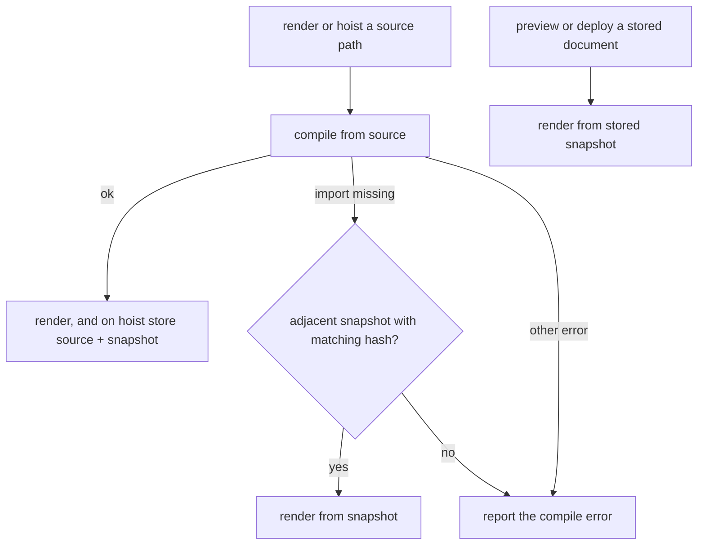

# ADR-0018: trusted MDX with pinned self-contained snapshots

- Status: Accepted
- Date: 2026-10-29
- Amends: ADR-0007 §F1 (adds MDX to the canonical document), ADR-0011 (stored MDX
  carries a snapshot file)

## Context

MDX lets an author use components, imports, and expressions. All three run as code in
the Planloft process at compile and render time, so MDX can never be safe input the way
Markdown is.

Stored documents outlive the files they import. Preview and deploy run later, often
from another directory, after the author has moved or deleted the imported `.tsx` or
`.mdx` files. A stored document that recompiles on every preview would stop rendering
when that happens.

## Decision

The package build bundles the private MDX compiler. It remains a development
dependency rather than an installed production dependency, because its transitive
MDX declarations expect a global JSX namespace that React 19 no longer provides.
Planloft's public declarations expose its own compile options and React component
types. The isolated production-consumer check runs with declaration checking enabled.

### M1. MDX is trusted input only

Render, hoist, and publish of MDX require `--trusted-mdx`. Imports, expressions, and
registry files are executable code. The snapshot is executable code too. Planloft
records a source hash to detect edits, but the hash is not a signature.

### M2. Hoist stores a self-contained minified snapshot

Hoist compiles the document and bundles it with its imports, registry components,
the built-in components, and their runtime (React server rendering, charts, tables)
into one minified `<document>.mdx.bundle.js` beside the stored source. Copy writes the
snapshot with the source.

Snapshots written before minification stay readable, so existing stored documents
keep rendering. The snapshot stays pinned. Preview and deploy of a stored document
render from its snapshot and never recompile it. Component fixes and Planloft upgrades therefore do not
reach a stored document until it is hoisted again from its source. We accept that
because a stored document then renders the same way after its dependencies move, and
because a re-hoist is a deliberate, visible step.

### M3. Source paths compile first

`render <path>` and `hoist <path>` compile the source from its own location before
looking at any adjacent snapshot. They use an adjacent snapshot only when compilation
fails because an import is genuinely missing and the snapshot's source hash matches
the current source. Any other compile error is reported as is. An edited copy therefore
compiles from its new location, and an edited registry component shows up on the next
render of a source path.

### M4. Built-ins and registries are implicit components

Built-in tags work without imports. Registry exports from the project and the Planloft
home are added in project, global, built-in order. Explicit imports use their imported
binding.

## Consequences

- One snapshot is large because it includes the runtime. A one-`Callout` document
  measured 776,466 bytes, 240,700 gzipped. Copied
  documents put that file into the user's repository.
- A stored document never changes underneath its author, and it never gets fixes for
  free either. Release notes for component fixes must tell authors to re-hoist.
- Changing the snapshot format later is a data migration of every stored and copied
  MDX document.

## Rejected

- **Recompile stored documents on every render.** Breaks as soon as an import moves.
- **Pin only the document and user imports, resolve components from the installed
  package.** Smaller files and free fixes, but a stored document's output then depends
  on whichever Planloft version renders it, and a breaking component change silently
  alters old documents.
- **Prefer the adjacent snapshot for source paths.** That made an edited copy fail
  with a stale-snapshot error and rendered stale registry components without warning.
- **Unminified snapshots.** About 1.9 MB per document for no benefit to the reader.
