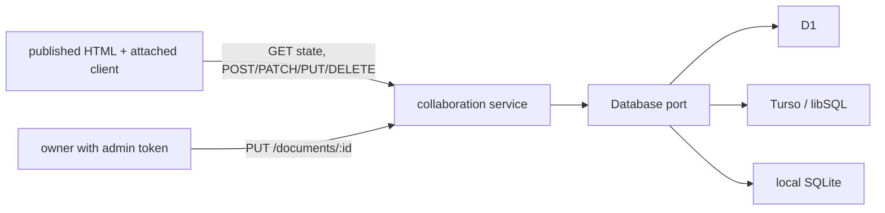

# ADR-0020: collaboration service ports, public viewer access, and idempotent writes

- Status: Accepted
- Date: 2026-10-29

## Context

Readers of a published Planloft document want to comment on text, keep shared notes,
and tick shared tasks. Published documents are static files on GitHub Pages, Vercel,
or Cloudflare, so the shared state needs a separate service. The same service code has
to run on Cloudflare Workers with D1, on Vercel with Turso, and locally on Node with
SQLite.

## Decision

### C1. One service behind a small database port

`createCollaborationService(db, adminToken)` is a plain `Request => Response` handler.
It depends only on a `Database` port with `execute` and `batch`. Adapters exist for D1,
libSQL/Turso, and a structural SQLite handle, so the Workers bundle never imports
`node:sqlite`. `planloft collaboration-build --provider local|cloudflare|vercel`
generates the entry file and SQL migration for each host. Generation never deploys.

Request and response shapes are parsed by one parser kit in `contracts.ts`, shared by
the service and the browser client. Task keys use the same `TASK_KEY` rule in the
`Todo` component and the service.

### C2. Viewers are public and equal

There are no viewer accounts. Anyone who can load the document and reach the service
can read state, create threads and replies, resolve and reattach threads, delete any
thread or reply, create and edit notes, and change tasks. The admin token only
registers documents and their revision. It lives on the server and never in the HTML.

This matches how the documents are already shared: by an unguessable link to a public
page. Planloft says so plainly in the user docs instead of implying ownership it does
not enforce.

### C3. Retries are idempotent and deletions stick

Creation requests carry an `Idempotency-Key`. A repeat with the same key and payload
returns the original record. The same key with a different payload is a conflict.
Deleting a thread or reply keeps its creation keys as tombstones with the stored
payload erased, in the same transaction, so a delayed retry cannot bring deleted text
back. Notes use optimistic version checks. Tasks use per-key versions.

### C4. Load once, no polling

The client fetches state on load and then applies the results of its own mutations.
It does not poll and keeps no live connection. Readers reload to see other readers'
changes.

### C5. Bounded retained data

The service caps live threads, replies, notes, and task keys per document, plus the
permanent creation identities that include tombstones. It also caps body and anchor
length and keeps the latest 20 revisions of each note. Each insert checks its count
inside the same `INSERT … SELECT`, so concurrent writes cannot overshoot. A write over
a cap returns HTTP 409 `capacity_exceeded`. Deleting content never frees creation
identities, because the tombstones are what make retries safe. The values live in
`COLLABORATION_LIMITS` in `contracts.ts`.

There is no whole-document byte budget, pagination, or rate limit. Every state request
still returns the whole document's state. The caps bound new data; data stored before
the caps existed is kept as is.

## Consequences

- Anyone with the link can delete comments or rewrite notes. Documents that need
  accountability should not enable collaboration.
- Concurrent readers do not see each other's changes until they reload.
- The provider artifacts are bundled and mock-tested. They are not proven against
  live D1, Turso, or Vercel limits.

## Rejected

- **Viewer accounts or per-author ownership.** Requires identity on static pages and
  a login flow for every reader.
- **Polling or websockets.** More hosted cost and moving parts than a review document
  needs.
- **Hard deletes of creation keys.** A retry after a lost response would recreate the
  deleted comment.
